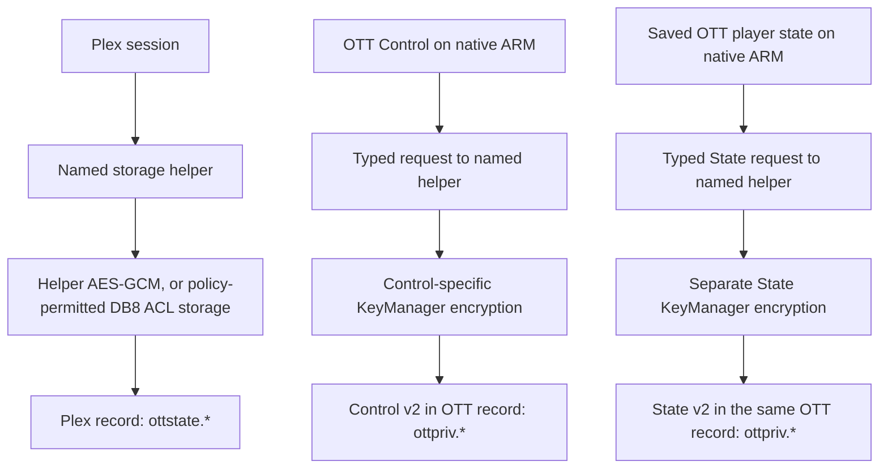

# Why Plex sign-in can work while OTT Save fails

This describes the native ARM storage paths in this source tree.
It is not evidence that a particular package or television has passed persistence
checks. For installation and verification steps, use the
[native delivery guide](ott-native-delivery.md#update-without-assuming-that-state-survived).

Plex, native ARM OTT Control and the saved OTT player state use the same named
storage helper, with separate keys, records and fallback policies. Saved player
state includes provider profiles, Favorites, playback positions and settings
for the local torrent service.

## Plex: helper-owned protection with explicit fallback policy

The helper registers as `<app-id>.storage` and creates a private DB8 kind owned
by that same service. Plex credentials live in its `ottstate.*` record. These
are source-defined identities; the firmware must still admit the actual
operation. See [helper registration][helper], [DB8 ownership][db8] and
[record identity][identity].

For fresh authentication, explicit reauthentication or legacy import, the
[Plex policy][policy] requests DB8 ACL-only storage on platform major versions
1–4. On newer or unclassified versions it tries KeyManager encryption and
allows an ACL-only result if sealing fails. That authorized fresh-write path
also permits ACL fallback if [decrypting or verifying its newly written
encrypted record fails][plex-readback]. Routine refresh preserves an
existing encrypted record's encryption requirement; an existing ACL-only
record can remain ACL-only.

The [ACL envelope][protection] contains plaintext inside the private DB8
record. It is access-controlled storage, **not encryption**. A separate
[guarded legacy file fallback][legacy] may also retain a marked, owner-only
session file after a non-durable canonical attempt. It refuses to downgrade
known protected state and does not turn that canonical attempt into a durable
success.

Consequently, a successful Plex login or a visible library does not establish
which protection path stored the credentials, or that a durable write happened.
The [login owner][login-owner] tracks durable completion separately and can
allow entry after an unsaved-login warning is acknowledged.

## OTT Control on native ARM: encryption in the named helper

The paired [ARM load/save adapter][control-load] selects the
[typed Control coordinator][control-coordinator]. It sends validated Control
fields to the named helper. The [Control backend][control-backend] encrypts
with a separate Control key and writes an installation-bound v2 envelope in
`ottpriv.*`. This path has **no ACL-only or plaintext fallback**; it does not
inherit Plex's fallback policy.

A durable result requires the matching commit receipt and a fresh stored
read/decrypt matching the exact configuration. A missing or uncertain result
is not reported as a successful protected Save. This is an integrated source
path, not a claim that the installed television has passed it.

## Saved player state and local torrent service

The [protected State coordinator][state-coordinator] uses the same authenticated helper transport and
canonical `ottpriv.*` record as Control, but a separate `ott.state.v2` key.
The [State backend][state-backend] accepts only the bounded saved-state document at this fixed slot;
callers cannot select a key or ask it to decrypt arbitrary ciphertext. The
existing application schema validation still governs profiles, settings and
Favorites.

For example, **Local torrent service → Start/retry service** first saves its
enabled setting and revision in this document. Only a confirmed durable save
allows the companion to apply that configuration. Failure or an uncertain
write does not start the service or silently discard its previous settings.
This also covers disabling the service and changing its cache size.

Loading, saving and Favorites inspection understand the State v2 envelope.
Read-only inspection uses the existing authenticated inspection connection:
it does not activate the helper, initialize storage, import legacy files,
generate a key or repair a record. Save requires the current revision and
erasure epoch, an exact stored candidate and a fresh decrypted readback.
There is no State plaintext or ACL fallback. Generic legacy writes cannot
replace a State v2 record with a v1 record.

## What still uses application-side cryptography

Host and hostsim builds retain the original [application-side private
writer][ott-writer] and [KeyManager adapter][app-keymanager]. On native ARM,
reading legacy v1 Control or State still requires the old application-side
decryption. The storage read operation alone does not create v2: a save first
requires successful legacy decoding and retains the original ciphertext. This
does not make application startup read-only: Favorites recovery and identity
migration may schedule a save, and shutdown can save playback checkpoints.
Take the appropriate state snapshot before launching a candidate. A decryption
failure remains a failure, not an absent record. A new helper-owned key cannot
recover an inaccessible application-owned legacy key.

An explicitly provisioned private `ottplay-control.json` remains a separate
managed authority, not a fallback file created after encryption fails. A
locked or invalid canonical Control record returns an error before that
managed path is considered.

## Public preferences already separated in this source

The [closed preference schema][preferences] permits the installation device ID,
normalized HTTPS controller address, Classic/Modern selection and bounded
browse bookmarks for temporary native-Plex sources, plus its format version.
Each bookmark holds source/category fingerprints and an optional focus key;
at most 16 source bookmarks are retained. Reuse requires current account and
source authorization: a bookmark cannot select a provider, start playback or
grant access. Tokens, endpoints and arbitrary settings are excluded from
bookmarks. The controller address excludes credentials, query strings,
fragments and percent escapes. These non-secret values use the existing helper
without KeyManager encryption; "public" does
not mean a publicly accessible database. A genuinely absent configuration can
therefore establish a disabled, tokenless identity. Full private state and
authenticated pairing still use their protected paths.

## Local profile export is read-only

`profile_export` returns the portable document previously persisted by
`profile_save`. A configured Local profile without that document returns
`Save this local profile before exporting it`. Export never allocates a binding
identity, schedules a save or bypasses write admission. Repeated exports of a
saved profile retain its binding identity and exclude private source paths.

## Installation and verification remain separate

The application and storage helper must be delivered as a matching pair.
Source integration or publishing a diagnostic canary does not establish a
successful protected Save, restart or authenticated reconnect on the TV.
Those results still need device receipts. The implementation described here
adds no OTT Control or State ACL fallback.

## Key Server is not KeyManager

Developer Mode's **Key Server** supplies the computer's SSH key for installing
and debugging apps, as shown in [LG's connection procedure][lg-key].
**KeyManager** is the credential-encryption service called by the code above.
Enabling Key Server is not a test of KeyManager access. OTT controller pairing
is a third, separate authorization exchange.

[helper]: ../rust-modules/platform/src/storage_service/service.rs#L54
[db8]: ../rust-modules/platform/src/storage_service/backend.rs#L133
[identity]: ../rust-modules/platform/src/storage/state.rs#L18
[policy]: ../rust-modules/plex/src/plex/session/persistence.rs#L725
[protection]: ../rust-modules/platform/src/storage_service/backend.rs#L982
[plex-readback]: ../rust-modules/platform/src/storage_service/backend.rs#L553
[login-owner]: ../rust-modules/session/src/auth/owner.rs#L1526
[legacy]: ../rust-modules/plex/src/plex/session.rs#L4621
[ott-writer]: ../rust-modules/platform/src/storage/private_helper.rs#L433
[app-keymanager]: ../rust-modules/platform/src/keymanager.rs#L94
[control-load]: ../rust-modules/src/app/ott_remote/transport.rs#L187
[control-coordinator]: ../rust-modules/platform/src/storage/control.rs#L118
[control-backend]: ../rust-modules/platform/src/storage_service/ott_control_backend.rs#L89
[state-coordinator]: ../rust-modules/platform/src/storage/saved_state.rs
[state-backend]: ../rust-modules/platform/src/storage_service/ott_saved_backend.rs
[preferences]: ../rust-modules/platform/src/storage_service/ott_wire.rs#L98
[lg-key]: https://webostv.developer.lge.com/develop/getting-started/developer-mode-app#connecting-tv-and-pc
